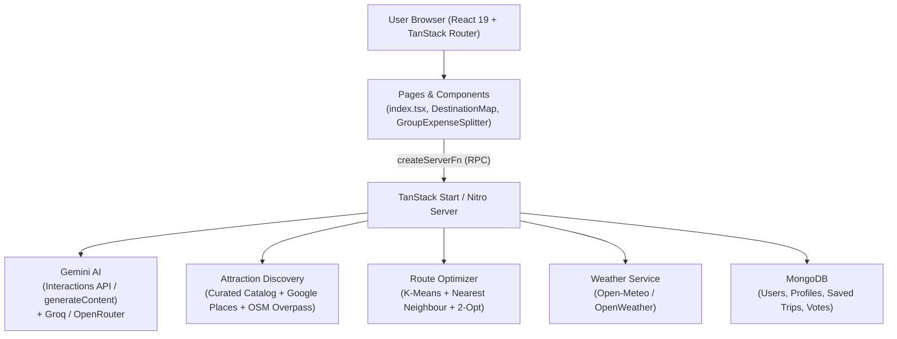
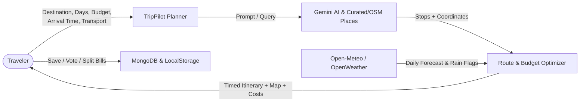
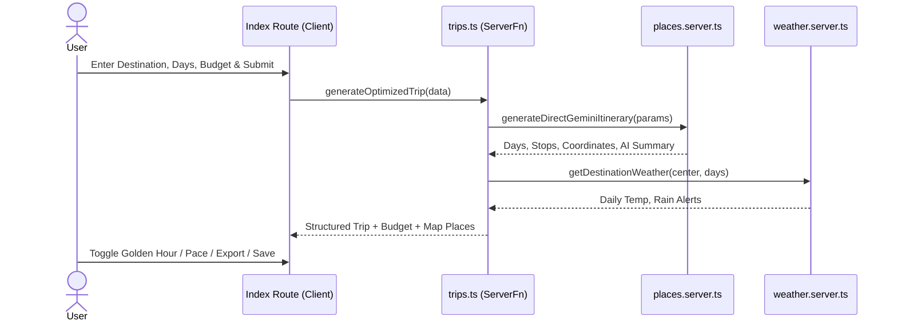

# TripPilot — AI-Powered Travel Itinerary Planner
**Project Report Reference Guide**

> This document maps every section of your Table of Contents directly to the actual **TripPilot** codebase, architecture, algorithms, test suite, and verified outputs.

---

## 1. Introduction

### 1.1 Problem Statement
Planning a multi-day trip (especially across Indian cities and tourist circuits) typically requires juggling disconnected tools: spreadsheets for budgets, Google Maps for pinning landmarks, weather apps for rain forecasts, and group chats for splitting bills and deciding stops. Existing static travel blogs offer generic lists without accounting for geographic backtracking, opening hours, local transit costs, or individual budgets.

### 1.2 Objectives
- Accept user inputs (**destination, number of days, per-person budget in INR, travel styles, travelers, arrival time, and local transport mode**) and generate a complete day-by-day itinerary.
- Sequence stops geographically (using K-Means clustering, Nearest-Neighbour ordering, and 2-Opt route improvement) to minimize backtracking.
- Integrate **Gemini AI** (`gemini-3.8-flash` via Interactions API / `generateContent`) with a **resilient zero-key fallback** (curated verified city attractions + OpenStreetMap Overpass/Nominatim) so itinerary generation never hangs or fails.
- Incorporate live daily weather forecasts (Open-Meteo / OpenWeather) with automatic indoor rain-swap recommendations.
- Provide practical travel utilities: interactive route map, budget breakdown chart, group split-bill calculator, WhatsApp export, `.ics` calendar export, offline pocket pass, and collaborative voting on shared trips.

### 1.3 Scope
- **Frontend**: Responsive web application built with React 19, TanStack Router/Start, and Tailwind CSS v4 (supporting light and dark themes).
- **Backend / Server Functions**: Type-safe TanStack Start server functions (`createServerFn`) for AI itinerary generation, attraction discovery, weather lookup, MongoDB persistence, and session authentication.
- **Target Users**: Solo travelers, families, and student/friend groups planning 1–14 day trips.

### 1.4 Significance
TripPilot eliminates manual route-planning friction by unifying AI itinerary generation, geographic optimization, live weather adaptation, and group expense settlement into a single shareable workspace.

---

## 2. System Analysis

### 2.1 Existing System
- **Manual Planning**: Travelers manually copy place names from blogs, check distances one by one on maps, and estimate costs in notes apps.
- **Generic AI Chatbots**: Plain text responses lack structured WGS84 coordinates, real-time opening-hour checks, interactive route reordering, budget sliders, or map pins.
- **Limitations**: High cognitive load, geographic backtracking, outdated/non-tourist suggestions, and no built-in group voting or expense splitting.

### 2.2 Proposed System
TripPilot combines LLM intelligence with deterministic route optimization:
- **Dual-Mode Generation**: Races Gemini Interactions API (`gemini-3.8-flash`) and `generateContent` in parallel; if unavailable or unconfigured, seamlessly falls back to curated landmarks + OpenStreetMap + `optimizeItinerary()`.
- **Interactive Editing**: Users can reorder stops, move stops between days, toggle **Golden Hour Mode**, switch **Trip Pace** (`Relaxed`, `Balanced`, `Packed`), adjust budget live, and anchor Day 1 to an **Arrival Time**.
- **Sharing & Collaboration**: Export to WhatsApp, `.ics` calendar, Offline Pocket Pass HTML, Print/PDF, or share a live `/trips/$id` URL where friends can vote (`👍` / `👎`) on stops.

### 2.3 Feasibility Study
- **Technical Feasibility**: Built on standard TypeScript, React 19, Vite, and MongoDB. All core map/weather/landmark lookups work even without paid Google Cloud Console keys (via Open-Meteo, OpenStreetMap Nominatim/Overpass, and Leaflet).
- **Economic Feasibility**: Zero mandatory API licensing cost for baseline operation; optional keys (`GEMINI_API_KEY`, `MONGODB_URI`, `OPENWEATHER_API_KEY`) use free/developer tiers.
- **Operational Feasibility**: Clean single-bar search interface on the hero banner, responsive mobile layout with a quick Map jump pill, and persistent local/MongoDB storage.

---

## 3. System Design

### 3.1 Architecture Diagram



### 3.2 Data Flow Diagrams (DFD) and UML Diagrams

#### Level-0 / Level-1 Data Flow Diagram


#### Sequence / Use-Case Flow (UML)


### 3.3 Module Descriptions
- **Routing & App Shell**: [__root.tsx](file:///c:/Users/Himan/Downloads/trippilot%20(1)/src/routes/__root.tsx), [SiteHeader.tsx](file:///c:/Users/Himan/Downloads/trippilot%20(1)/src/components/SiteHeader.tsx), [SiteFooter.tsx](file:///c:/Users/Himan/Downloads/trippilot%20(1)/src/components/SiteFooter.tsx), [BrandLogo.tsx](file:///c:/Users/Himan/Downloads/trippilot%20(1)/src/components/BrandLogo.tsx)
- **Planner & Discovery UI**: [index.tsx](file:///c:/Users/Himan/Downloads/trippilot%20(1)/src/routes/index.tsx), [explore.tsx](file:///c:/Users/Himan/Downloads/trippilot%20(1)/src/routes/explore.tsx), [how-it-works.tsx](file:///c:/Users/Himan/Downloads/trippilot%20(1)/src/routes/how-it-works.tsx)
- **Saved Trips & Collaboration**: [trips.index.tsx](file:///c:/Users/Himan/Downloads/trippilot%20(1)/src/routes/trips.index.tsx), [trips.$id.tsx](file:///c:/Users/Himan/Downloads/trippilot%20(1)/src/routes/trips.$id.tsx), [favourites.tsx](file:///c:/Users/Himan/Downloads/trippilot%20(1)/src/routes/favourites.tsx)
- **Authentication & Profile**: [AuthProvider.tsx](file:///c:/Users/Himan/Downloads/trippilot%20(1)/src/components/AuthProvider.tsx), [AccountForm.tsx](file:///c:/Users/Himan/Downloads/trippilot%20(1)/src/components/AccountForm.tsx), [auth.ts](file:///c:/Users/Himan/Downloads/trippilot%20(1)/src/lib/auth.ts), [profile.ts](file:///c:/Users/Himan/Downloads/trippilot%20(1)/src/lib/profile.ts)
- **Optimization & Data Engines**: [optimizer.ts](file:///c:/Users/Himan/Downloads/trippilot%20(1)/src/lib/optimizer.ts), [places.server.ts](file:///c:/Users/Himan/Downloads/trippilot%20(1)/src/lib/places.server.ts), [weather.server.ts](file:///c:/Users/Himan/Downloads/trippilot%20(1)/src/lib/weather.server.ts), [trips.ts](file:///c:/Users/Himan/Downloads/trippilot%20(1)/src/lib/trips.ts), [mongodb.server.ts](file:///c:/Users/Himan/Downloads/trippilot%20(1)/src/lib/mongodb.server.ts)
- **Interactive Widgets**: [DestinationMap.tsx](file:///c:/Users/Himan/Downloads/trippilot%20(1)/src/components/DestinationMap.tsx), [BudgetBreakdownChart.tsx](file:///c:/Users/Himan/Downloads/trippilot%20(1)/src/components/BudgetBreakdownChart.tsx), [GroupExpenseSplitter.tsx](file:///c:/Users/Himan/Downloads/trippilot%20(1)/src/components/GroupExpenseSplitter.tsx), [CityAutocomplete.tsx](file:///c:/Users/Himan/Downloads/trippilot%20(1)/src/components/CityAutocomplete.tsx), [PlaceDetailDialog.tsx](file:///c:/Users/Himan/Downloads/trippilot%20(1)/src/components/PlaceDetailDialog.tsx)

---

## 4. Code of the Project

### 4.1 Main Entry Point
- Root document & providers: [__root.tsx](file:///c:/Users/Himan/Downloads/trippilot%20(1)/src/routes/__root.tsx) (`QueryClientProvider`, `AuthProvider`, `SiteHeader`, `<Outlet />`, `SiteFooter`).
- Primary planner route: [index.tsx](file:///c:/Users/Himan/Downloads/trippilot%20(1)/src/routes/index.tsx) (`Route = createFileRoute('/')`).

### 4.2 Module and Class Overview
TripPilot uses functional TypeScript modules and React components rather than heavy OOP class hierarchies:
- **Pure Algorithmic Module**: `optimizer.ts` (clustering, TSP 2-Opt, scheduling, weather adjustment, Golden Hour sequencing, ICS/HTML generation).
- **Server-Only Modules (`*.server.ts`)**: `places.server.ts`, `weather.server.ts`, `mongodb.server.ts` (keep API keys and database connections strictly server-side).
- **UI Components**: Stateless/stateful React 19 components styled with Tailwind CSS v4 tokens in [styles.css](file:///c:/Users/Himan/Downloads/trippilot%20(1)/src/styles.css).

### 4.3 Important Functions
- `generateOptimizedTrip` ([trips.ts](file:///c:/Users/Himan/Downloads/trippilot%20(1)/src/lib/trips.ts)) — Orchestrates AI generation, arrival-time anchoring, start-point geocoding, and weather enrichment.
- `generateDirectGeminiItinerary` & `discoverAttractions` ([places.server.ts](file:///c:/Users/Himan/Downloads/trippilot%20(1)/src/lib/places.server.ts)) — Parallel Gemini API racing (`Promise.any`) + curated/OSM landmark discovery.
- `optimizeItinerary`, `kMeansCluster`, `twoOptImprove`, `applyGoldenHourMode`, `replanForBudget`, `applyWeatherAdjustment` ([optimizer.ts](file:///c:/Users/Himan/Downloads/trippilot%20(1)/src/lib/optimizer.ts)).
- `computeSettlements` ([GroupExpenseSplitter.tsx](file:///c:/Users/Himan/Downloads/trippilot%20(1)/src/components/GroupExpenseSplitter.tsx)) — Greedy debt-simplification algorithm for *"Who Owes Whom"*.

### 4.4 Configuration File Access
- Environment variables (`GEMINI_API_KEY`, `GOOGLE_API_KEY`, `MONGODB_URI`, `AUTH_SECRET`, `OPENWEATHER_API_KEY`, etc.) are accessed exclusively in server functions via `process.env['KEY_NAME']` — never exposed to browser bundles.
- Design tokens and Tailwind v4 theme configuration live in [styles.css](file:///c:/Users/Himan/Downloads/trippilot%20(1)/src/styles.css).

### 4.5 Error Handling Mechanism
- **Input Validation**: All server functions validate payloads with `zod` schemas (`GenerateSchema`, `SaveTripSchema`, etc.).
- **Timeouts & Graceful Degradation**: External fetches use `AbortSignal.timeout(...)`. If Gemini or OpenWeather fails, the app falls back to Open-Meteo and the local route optimizer instead of crashing.
- **UI Feedback**: Client `try / catch / finally` blocks surface accessible `role="alert"` banners and reset loading spinners cleanly.

### 4.6 Compatibility with Windows Versions
- Runs on **Windows 10 / Windows 11** (and macOS/Linux) via Node.js + Vite + Nitro.
- All file paths in Vite/TypeScript use platform-independent `@/` path aliases (`tsconfig.json`), and browser exports (`.ics`, `.html`, clipboard, `window.print()`) use standard Web APIs.

### 4.7 Reusability and Modularity
- Route math, packing checklists, food suggestions, and ICS/HTML exports are isolated in `src/lib/optimizer.ts` so both `index.tsx` and server functions reuse identical logic.
- Shared UI components (`BrandLogo`, `AccountForm`, `DestinationMap`, `GroupExpenseSplitter`) are decoupled from route files.

---

## 5. Implementation

### 5.1 Tools / Technologies Used
| Layer | Technology |
|---|---|
| **Frontend Framework** | React `^19.2.0`, TypeScript |
| **Routing & SSR/RPC** | TanStack Router (`1.170.42`), TanStack Start (`1.168.61`), TanStack Query (`^5.101.1`) |
| **Styling & UI** | Tailwind CSS v4 (`^4.3.5`), Radix UI primitives, Lucide React (`^0.575.0`), Recharts (`^2.15.4`) |
| **Validation & Forms** | Zod (`^4.6.7`), React Hook Form (`^7.71.2`) |
| **Database** | MongoDB (`^7.9.1`) |
| **AI & External APIs** | Gemini (`gemini-3.8-flash` / `2.5-flash`), Open-Meteo, OpenStreetMap (Nominatim & Overpass), Leaflet |
| **Build & Testing** | Vite, Nitro, Vitest, Testing Library (`@testing-library/react`), ESLint, Prettier |

### 5.2 Screenshots of the Software
*(Capture screenshots from your live deployment or local `npm run dev` for the final report:)*
1. Homepage Hero (`heroimg.jpg` + `Build Custom Travel Plans` bar + `Hot Picks` / `Top Destinations`)
2. Loading Animation (`PlanningProgressView` with progress bar & shimmer skeleton)
3. Generated Multi-Day Itinerary (Bold stop titles, Day route buttons, Sticky Map, Budget Chart, Group Split-Bill)
4. Shared Trip Voting View (`/trips/$id`) & Sign-in/Profile pages (`/auth`, `/profile`)

### 5.3 Description of Important Functions and Modules
*(Use the summaries from Sections 3.3 and 4.3, highlighting `optimizeItinerary` for K-Means + 2-Opt route shortening, `applyGoldenHourMode` for morning/sunset outdoor scheduling, and `GroupExpenseSplitter` for minimum-transfer bill splitting.)*

---

## 6. Testing

### 6.1 Test Cases
The automated Vitest suite (`npm test -- --run`) verifies **30 test cases across 7 test files**:
1. `src/test/destinations.test.ts` (2 tests) — Validates destination catalog structure and coordinates.
2. `src/test/imported-places.test.ts` (4 tests) — Validates imported attraction dataset integrity.
3. `src/test/city-search.test.ts` (4 tests) — Tests city autocomplete & spelling resolution.
4. `src/test/optimizer.test.ts` (11 tests) — Tests K-Means clustering, 2-Opt route distance improvement, budget fitting, weather adjustment, energy score, India practical alerts, route food suggestions, and offline pass HTML generation.
5. `src/test/site-header.test.tsx` (2 tests) — Verifies `Sign in` button visibility while loading and when signed out.
6. `src/test/account-form.test.tsx` (1 test) — Tests MongoDB sign-up flow and post-auth navigation.
7. `src/test/app-routing.test.tsx` (6 tests) — Verifies client/server route definitions and navigation paths.

### 6.2 Expected vs Actual Results Table
| Test File | Cases | Expected Result | Actual Result | Status |
|---|---:|---|---|---|
| `destinations.test.ts` | 2 | Valid destinations & coordinates | All 2 passed | Pass |
| `imported-places.test.ts` | 4 | Valid attraction entries | All 4 passed | Pass |
| `city-search.test.ts` | 4 | Accurate city match & fuzzy spelling | All 4 passed | Pass |
| `optimizer.test.ts` | 11 | Optimal routes, costs, alerts, HTML pass | All 11 passed | Pass |
| `site-header.test.tsx` | 2 | Sign-in link visible immediately | All 2 passed | Pass |
| `account-form.test.tsx` | 1 | Sign-up succeeds & navigates home | 1 passed | Pass |
| `app-routing.test.tsx` | 6 | All primary routes resolve cleanly | All 6 passed | Pass |
| **Total** | **30** | **All 30 tests pass + 0 TS errors** | **30/30 passed (`tsc --noEmit` = 0)** | **Pass** |

### 6.3 Bug Reports and Fixes
1. **Model Deprecation & Hanging Requests**: Replaced deprecated `gemini-2.0-flash` with `gemini-3.8-flash` (Interactions API + `generateContent` raced via `Promise.any`), and added an automatic fallback to `discoverAttractions` + `optimizeItinerary` so requests never hang.
2. **Non-Tourist Overpass/Wikipedia Places**: Filtered out `amenity=cafe`/`place_of_worship` noise and added `landmarkPattern` filtering so only real tourist landmarks appear.
3. **Thumbnail URL 404s**: Stopped rewriting Wikipedia `/330px-` thumbnails to `/800px-` and removed mismatched fallback stop boxes in favor of clean bold-title cards.
4. **Sign-In Button Hidden While Loading**: Updated `SiteHeader.tsx` so the Sign-In CTA renders immediately even while auth state initializes.

---

## 7. Conclusion and Future Scope

### 7.1 What Has Been Achieved
TripPilot delivers an end-to-end, responsive AI travel planner that takes a destination, duration, and budget and produces a geographically ordered multi-day itinerary with live weather, interactive mapping, group bill splitting, WhatsApp/calendar/offline exports, and collaborative trip voting—verified by 30 passing automated tests and a clean production build.

### 7.2 Limitations
- Live LLM prose requires a valid `GEMINI_API_KEY` (or fallback AI key); without one, the system uses its deterministic curated/OSM optimizer.
- Public OpenStreetMap Overpass mirrors may occasionally throttle heavy requests for uncached obscure towns.
- Collaborative voting and saved trip persistence require a configured `MONGODB_URI`.

### 7.3 Possible Future Enhancements
- Multi-city roadtrip chaining (*Delhi → Agra → Jaipur*) with intercity train/bus/flight legs.
- Direct hotel & activity booking deep-links with live availability.
- Real-time collaborative WebSocket cursor/live-edit rooms for group trip planning.
- Progressive Web App (PWA) installability for full offline mobile caching.

---

## 9. Appendix

### 9.1 Source Code
Repository: `https://github.com/himanshu-dev2005/trippilot` (branch `main`). Key directories: `src/routes/`, `src/components/`, `src/lib/`, `src/test/`.

### 9.2 Installation Steps
```powershell
# 1. Clone the repository
git clone https://github.com/himanshu-dev2005/trippilot.git
cd trippilot

# 2. Install dependencies
npm install

# 3. (Optional) Configure environment variables in .env
# GEMINI_API_KEY=...
# MONGODB_URI=...
# AUTH_SECRET=...
# OPENWEATHER_API_KEY=...

# 4. Run development server
npm run dev

# 5. Run typecheck, tests, and production build
npx tsc --noEmit
npm test -- --run
npm run build
```

### 9.3 Sample Input and Output
- **Sample Input**:
  - Destination: `Dehradun`
  - Duration: `3` days
  - Budget per person: `₹5,000`
  - Travel Style: `Nature & Parks, Culture & Heritage`
  - Transport: `Cab / Auto` · Arrival Time: `10:00`
- **Sample Output**:
  - **Day 1**: `10:00` Robber's Cave (Guchhupani) → `12:25` Forest Research Institute (FRI) → `14:50` Tapkeshwar Mahadev Temple
  - **Day 2**: `09:00` Sahastradhara Sulphur Springs → Mindrolling Monastery → Malsi Deer Park
  - **Day 3**: Paltan Bazaar → Clock Tower → Rajpur Road cafés
  - **Generated Outputs**: Per-day cost & travel time, live Open-Meteo weather summary, WhatsApp share text, 1-click Google Maps multi-stop route links, interactive Leaflet map, budget breakdown chart, and group split-bill calculator.
